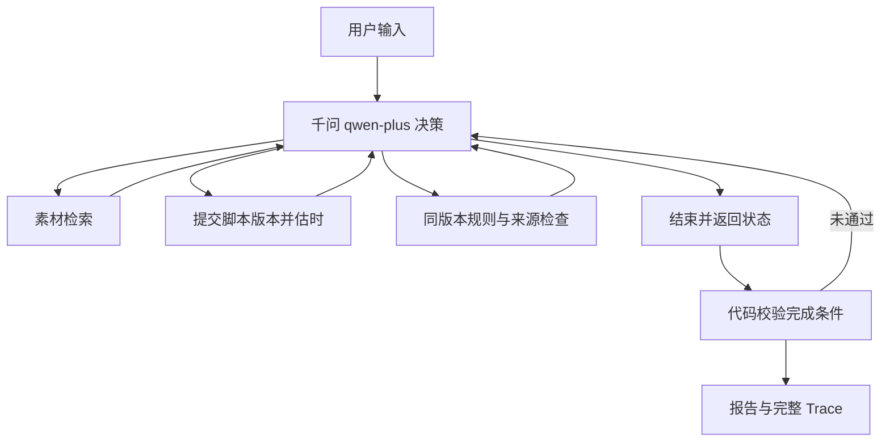

# 方案、动态决策与技术取舍

## 调用流程

图中的分支由模型选择。工具失败、检索不足、超时和规则问题都作为结构化观察送回模型；主循环没有针对案例 ID 的路由表。

使用千问兼容接口的原生 `tool_calls`，将 assistant 工具调用及对应 tool 返回送入下一轮。`reason` 是基于可见事实的一句行动依据，不要求、保存或展示内部思维过程。`enable_thinking=false`；只保存可核对的参数、工具结果和接口 usage 等元数据。

若模型给出无法解析的工具参数，工具不执行，返回 `INVALID_JSON`。Trace 保存原始 `raw_arguments`，并标记 `history_arguments_normalized`；为避免兼容接口拒绝后续整段历史，只在发送给接口的历史副本中把该参数规范为 `{}`。这不把原始调用伪装为有效调用，模型仍看到格式错误观察并决定下一步。回放器会重新验证原始参数确实无效。

## 工具

| 工具 | 输入 | 主要返回 |
|---|---|---|
| `search_materials` | 查询与简要依据 | 产品范围内的资料、版本、事实及核准表达 |
| `estimate_duration` | 完整脚本与简要依据 | 内容哈希版本、逐镜估时、是否超限 |
| `check_rules` | 脚本版本与简要依据 | 逐镜规则问题、引用及原文 |
| `finish` | 状态、说明、版本、缺口、简要依据 | 校验通过的任务终态 |

资料搜索采用英文词与中文连续词/双字片段匹配，按匹配数排序并限制当前产品，返回最多五条。结果可解释、方便更换资料；对复杂同义词的召回能力有限。是否重新检索、如何改写查询由模型决定。

## 两类职责

模型选择查询、内容结构、分镜画面和候选表达，依据反馈决定删除、重排、压缩、重查或停止。画面与标题从工具返回的受控选项中选择；模型仍决定镜头组合、事实取舍、停留时长及下一步动作。

程序执行确定性约束：输入类型与长度、产品范围、原文和核准表达、禁止宣称、时长计算、版本与调用上限。约束不能依赖模型自觉遵守。真实模型有决策空间，代码也不接受没有检查依据的成功声明。

## 事实边界

旁白由 fact / bridge / cta 片段构成。fact 必须引用本次检索实际见到的事实，文本必须等于对应原文或核准表达；bridge、cta 必须选自品牌核准用语，不能夹带产品宣称。屏幕文字也受来源约束。报告将分镜、实际使用文字、事实 ID、素材 ID、版本和原文逐一列出。

当前资料只有产品文字事实，没有界面截图或录屏。旧版只给自由画面加“待确认”，仍放过了自动生成字幕和比例切换等无依据能力暗示。新版采用明确的创作边界：标题选择中性核准用语；画面选择中性人物/纸质分镜镜头、明确的界面占位，或“展示素材原文文字卡：”加上本镜已引用的事实原文。检索返回 `creative_options`，规则失败也返回本镜可用选项。其他分镜使用的事实不能自动授权本镜画面。

`UNSUPPORTED_VISUAL` 会阻止不在上述范围内的画面完成；“待确认”不能豁免新增能力。界面占位仍列为待确认，须补真实截图/录屏后再细化。`UNAPPROVED_TITLE` 阻止标题加入新的产品宣称。新规则针对完整字段校验，不能靠添加一个未列入关键词黑名单的说法绕过。

这是用受控表达换取可核对的事实边界，代价是标题和画面的创作自由较小；不宣称解决任意自由文本的语义判断。素材原文本身、真实图像含义、真实品牌法规和实际成片仍需人工复核。

## 时长计算

逐镜时长为三者最大值：

1. 模型给出的画面停留秒数。
2. 文本口播单位数 / 语速 × 安全系数 + 镜头停顿。
3. 屏幕文字单位数 / 字幕阅读速度。

按 0.1 秒向上取整后相加。默认中文每字 1 单位、英文每词 1.8、数字串 2；语速 4 单位/秒，安全系数 1.15，停顿 0.35 秒。模型无法提供“总时长”覆盖计算结果。调小画面停留仍受真实旁白长度约束。非真实 TTS，不能等同于成片实测。

## 版本一致性与状态

提交完整脚本经过校验后，以规范 JSON 的 SHA-256 产生版本 ID，保留不可变副本。时长和规则结果都附该版本与完整哈希。修改任何脚本字段后必须重新估算、检查；完成状态只接受最新提交版本且两项检查均通过。

资料、品牌、估时参数及受控创作策略在每次任务启动时加载为快照，并在结果中记录统一哈希。修改资料后启动新任务会生成新的快照标识。没有以哈希宣称模型本身的真实性可被密码学证明。

终态有 completed / needs_input / blocked / incomplete / tool_failed。达到轮数或工具调用上限明确 incomplete，并保留已有结果。工具端故障不创建成功产物。HTTP 请求不自动重试，避免隐藏费用和重复请求。

## 选型

Python 标准库原生实现，不使用 Agent 框架，因此无框架版本与职责。优点是调用循环短、边界清楚、无安装成本；代价是模型协议、校验和记录需自行维护。具体模型为用户选择的 `qwen-plus`，API 采用阿里云兼容接口，参考官方 [Function Calling](https://help.aliyun.com/zh/model-studio/qwen-function-calling)。

离线 `MockProvider` 是明确的固定策略测试替身，验证工具与记录路径，不作为真实模型 ReAct 决策证据。
